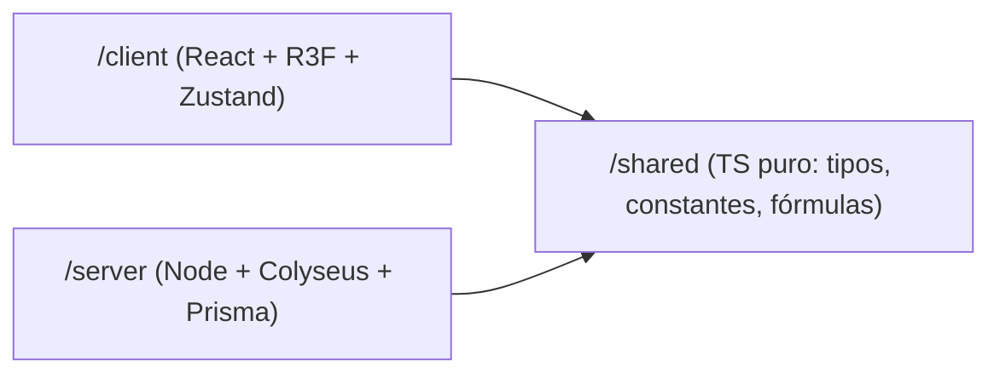
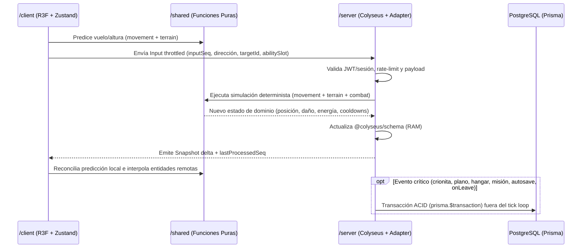

# ARCHITECTURE.md — Reglas Estrictas de Arquitectura y Desarrollo (v1.1)

> **Documento rector del proyecto (`StarCorsair`).** Toda funcionalidad, módulo, PR o refactorización debe cumplir sin excepción las reglas definidas en este archivo.

---

## 1. Definición del Proyecto

- **Tipo de juego:** MMORPG de combate espacial en tercera persona sobre superficie planetaria y órbita (sucesor moderno de *Pirate Galaxy*).
- **Modelo de ejecución:** Arquitectura **Server-Authoritative** (servidor autoritativo) con **Client-Side Prediction & Reconciliation** (predicción y reconciliación en cliente) sobre un **monorepo TypeScript**.

---

## 2. Estructura del Monorepo

El repositorio se organiza en tres paquetes principales con fronteras estrictas:

```text
/
├── ARCHITECTURE.md          # Reglas estrictas de arquitectura (este archivo, v1.1)
├── package.json             # Workspaces del monorepo (client, server, shared)
├── tsconfig.base.json       # Configuración TypeScript estricta compartida
├── docker-compose.yml       # Entorno local reproducible (PostgreSQL)
├── shared/                  # Núcleo matemático y contratos compartidos (TS puro)
│   └── src/
│       ├── types/           # Tipos TS, entidades, snapshots y mensajes de red
│       ├── constants/       # Constantes de armas, habilidades, naves, planetas
│       ├── combat/          # Funciones puras de daño, rangos, energía y cooldowns
│       ├── movement/        # Funciones puras de física/vuelo sobre superficie planetaria
│       ├── terrain/         # Relieve planetario determinista getTerrainHeight(planetId, x, z)
│       ├── spatial/         # Utilidades de grilla 2D / Area of Interest (AOI) puras
│       └── index.ts
├── client/                  # Cliente 3D Web
│   └── src/
│       ├── game/            # Escena React Three Fiber / Three.js, terreno, naves, VFX
│       ├── network/         # Cliente Colyseus, envío throttled de inputs, reconciliación e interpolación
│       ├── store/           # Estado UI/HUD y sesión en Zustand
│       ├── ui/              # HUD estilo sci-fi, barra 1–8, radar, hangar (TailwindCSS)
│       └── main.tsx
└── server/                  # Servidor Autoritativo y Persistencia
    ├── prisma/              # schema.prisma, migraciones PostgreSQL y seed.ts
    └── src/
        ├── schemas/         # Capa Adapter @colyseus/schema (deltas binarios de red)
        ├── rooms/           # Salas Colyseus (PlanetRoom, OrbitRoom)
        ├── systems/         # Simulación por tick fijo (movimiento, combate, IA, loot)
        ├── services/        # Acceso transaccional a PostgreSQL vía Prisma + Auth/Sesión única
        └── index.ts
```

### Stack Tecnológico Oficial por Paquete

| Paquete | Tecnologías Obligatorias | Responsabilidad |
| :--- | :--- | :--- |
| **`/client`** | React, Vite, TailwindCSS, React Three Fiber (`@react-three/fiber`) / Three.js, Zustand, `colyseus.js` | Renderizado 3D, entrada del jugador, predicción local, interpolación visual y HUD. |
| **`/server`** | Node.js, TypeScript, Colyseus, PostgreSQL, Prisma ORM | Simulación autoritativa en tiempo real (salas planetarias/órbita), IA, validación anti-trampas y persistencia. |
| **`/shared`** | TypeScript puro (sin dependencias de DOM, Three.js, Colyseus ni Prisma) | Única fuente de verdad para tipos, constantes de juego y fórmulas puras de combate, movimiento, terreno y AOI. |

---

## 3. Reglas Estrictas e Inquebrantables

### Regla 1 — Nunca calcular daño ni movimiento definitivo solo en el cliente
- El cliente **jamás** decide daño aplicado, vida restante, escudo, energía final, enfriamientos definitivos, drops de crionita/planos ni la posición autoritativa de ninguna entidad.
- El cliente únicamente envía **intenciones / inputs** al servidor (vector de dirección/destino, objetivo seleccionado, solicitud de activar habilidad `1–8`).
- El servidor valida cada input (distancia, energía disponible, cooldown, estado vivo/muerto, velocidad máxima) y emite el estado definitivo mediante Colyseus.

### Regla 2 — Toda la lógica de combate y movimiento en funciones puras dentro de `/shared`
- Toda fórmula de combate (daño base, mitigación/escudo, alcance, cadencia, consumo de energía, reparación, efectos de estado) y toda ecuación de cinemática/movimiento (aceleración, velocidad con postquemador, rotación, altura sobre el relieve planetario) **debe vivir en `/shared` como funciones puras deterministas**.
- **Definición de función pura en este proyecto:**
  - Mismas entradas ⇒ exactamente la misma salida.
  - Sin efectos secundarios (no muta argumentos externos, no lee `Date.now()` ni `Math.random()` directamente, no depende de estado global).
  - Tiempo (`dt`, `nowMs`) y aleatoriedad (`rngRoll`) se pasan explícitamente como parámetros.
- Tanto **`/client`** (para predicción inmediata y tooltips/UI) como **`/server`** (para simulación autoritativa) **deben importar exactamente las mismas funciones y constantes de `/shared`**. Queda prohibido duplicar fórmulas entre cliente y servidor.

### Regla 3 — Grafo de Dependencias Estricto (Reforzado por Linter)

- **`/shared` NO puede importar** nada de `/client` ni de `/server`, ni librerías acopladas al navegador, renderizado, red o base de datos.
- **`/client` NO puede importar** nada de `/server` ni de Prisma.
- **`/server` NO puede importar** nada de `/client`, React ni Three.js.
- Estas fronteras deben quedar bloqueadas mecánicamente mediante reglas de ESLint (`no-restricted-imports`).

### Regla 4 — Simulación Autoritativa por Tick Fijo y Reconciliación
- El servidor ejecuta la simulación de cada planeta en un bucle de paso fijo (*fixed timestep*, `20 Hz` / `50 ms` por defecto, configurable hasta `30 Hz`) dentro de `PlanetRoom`, aplicando acumulador de `dt` con límite máximo (`Math.min(deltaMs, 250)`) para evitar saltos físicos ante picos de CPU.
- El cliente predice su propio movimiento inmediato usando `shared/movement` + `shared/terrain` con número de secuencia monotónico (`inputSeq`) y **reconcilia** suavemente su posición al recibir `lastProcessedSeq` del servidor.
- Las demás naves (otros jugadores y enemigos IA) se renderizan mediante **interpolación** entre snapshots recibidos del servidor.

### Regla 5 — Seguridad, Economía y Persistencia (PostgreSQL + Prisma)
- Toda operación persistente (compra de naves, equipamiento de tecnología, crionita, planos recolectados, progreso de misiones) se valida y ejecuta exclusivamente en `/server` mediante transacciones ACID (`prisma.$transaction`) contra **PostgreSQL**.
- Los eventos aleatorios con impacto económico o de combate (probabilidad de crítico, drop de planos, cantidad de crionita) se generan **únicamente en `/server`** (pasando el resultado a las funciones puras de `/shared` cuando aplique).

### Regla 6 — Rendimiento en el Cliente (React Three Fiber + Zustand)
- Los datos de alta frecuencia (`60+ FPS`) —posiciones 3D, rotaciones, proyectiles, partículas— **no deben disparar re-renders de React**; se leen directamente en `useFrame` vía referencias/buffers mutables o `zustand.getState()`.
- **GC-Friendly Loop:** Prohibido instanciar objetos temporales (`new THREE.Vector3()`, `new THREE.Quaternion()`) dentro de `useFrame`; reutilizar instancias pre-asignadas y emplear `InstancedMesh` / *object pooling* para láseres, partículas, orbes y props planetarios.
- **Zustand** gestiona el estado reactivo de la interfaz (HUD, barra de habilidades, objetivo actual, hangar, estado de conexión) con selectores atómicos y cuantización de barras/cooldowns.

### Regla 7 — Terreno Planetario Determinista Compartido (`/shared/src/terrain/`)
- El relieve planetario **no puede existir únicamente como malla visual en Three.js**.
- Cada planeta define su función determinista pura `getTerrainHeight(planetId, x, z)` (y sus límites/zonas de aterrizaje/obstáculos básicos) en `/shared/src/terrain/`.
- `/client` genera la geometría 3D del terreno muestreando exactamente `getTerrainHeight`, y `/server` calcula la altitud de vuelo, altura mínima sobre suelo y colisiones con esa misma función, garantizando paridad absoluta de elevación.

### Regla 8 — Capa Adapter `@colyseus/schema` Desacoplada (`/server/src/schemas/`)
- Para mantener `/shared` 100% libre de dependencias de Colyseus y decoradores `@type(...)`, la sincronización binaria por deltas vive exclusivamente en `/server/src/schemas/`.
- Los sistemas de `/server/src/systems/` ejecutan las funciones puras de `/shared` sobre el estado de dominio y proyectan el resultado hacia las clases `@colyseus/schema` mediante adaptadores explícitos (cero lógica de negocio duplicada en los schemas).

### Regla 9 — Política de Persistencia: RAM (Tiempo Real) vs PostgreSQL (Transaccional)
- **Prohibido ejecutar queries Prisma dentro del bucle de simulación (`setSimulationInterval` a 20–30 Hz).**
- **Estado volátil en RAM (Colyseus):** posición, rotación, velocidad, HP/escudo actual en combate, energía en combate, cooldowns, proyectiles y estado de IA.
- **Persistencia en PostgreSQL (Prisma, asíncrona/transaccional):**
  - Inmediata en eventos críticos de economía/progreso: compra/venta en Hangar, equipamiento de nave, recolección de crionita/planos y avance/cierre de misiones.
  - Periódica (*autosave* cada `30–60 s` solo si el estado persistible está marcado como *dirty*).
  - Obligatoria al abandonar sala (`onLeave`) y durante apagado elegante del servidor (*graceful shutdown*).

### Regla 10 — Autenticación, Sesión Única y Seguridad Anti-Cheat WebSocket
- Toda conexión a salas Colyseus se autentica mediante **JWT verificado en `onAuth`** (nunca aceptar un `pilotId` sin verificar desde el cliente).
- **Lock de Sesión Única por `pilotId`:** un mismo piloto no puede mantener dos conexiones activas simultáneas (prevención de duplicación de crionita, planos o equipamiento). Si inicia una nueva sesión válida, se cierra ordenadamente la anterior tras persistir su estado.
- **Hardening WebSocket:** *rate-limiting* por cliente/socket (rechazo y desconexión ante flood), validación estricta de payloads entrantes (rango numérico, `NaN`/`Infinity`, slots `1–8` válidos) y verificación de velocidad/distancia máxima por tick (anti-speedhack).

### Regla 11 — Presupuesto de Red y Area of Interest (AOI)
- **Throttling de Inputs:** `/client` envía comandos de movimiento muestreados a `20–30 Hz` (o ante cambio significativo de dirección/habilidad), nunca a la frecuencia cruda del monitor (`120/144 Hz`).
- **Partición Espacial (AOI):** `/shared/src/spatial/` provee una grilla 2D pura para consultar entidades por radio de interés; las salas planetarias deben contemplar filtrado espacial (`StateView` / AOI) para escalar a decenas de pilotos y NPCs sin saturar el ancho de banda.

---

## 4. Flujo de Combate y Movimiento (Referencia)



---

## 5. Estándares de Código y Verificación

1. **TypeScript estricto (`"strict": true`)** habilitado en `/shared`, `/client` y `/server`.
2. **Cero duplicación de constantes:** atributos de naves, daños de armas, alcances, costes de energía, enfriamientos y parámetros planetarios se declaran una sola vez en `/shared/src/constants/`.
3. **Pruebas unitarias obligatorias en `/shared` (Vitest):** toda fórmula de combate, movimiento, terreno y AOI debe contar con pruebas deterministas y de casos borde antes de integrarse en salas o escenas 3D.
4. **Checklist antes de considerar terminada cualquier feature:**
   - [ ] ¿Las matemáticas (combate, movimiento, terreno, AOI) y constantes están en `/shared` como funciones puras?
   - [ ] ¿El servidor valida (JWT, rate-limit, rango, energía, cooldown) y aplica el estado definitivo en RAM?
   - [ ] ¿Se evitó cualquier query Prisma dentro del bucle de ticks de 20–30 Hz?
   - [ ] ¿El cliente solo envía inputs throttled, predice/interpola sin decidir resultados finales y no crea basura GC en `useFrame`?
   - [ ] ¿Se respetaron las fronteras entre `/client`, `/server` y `/shared` (verificado por ESLint)?
